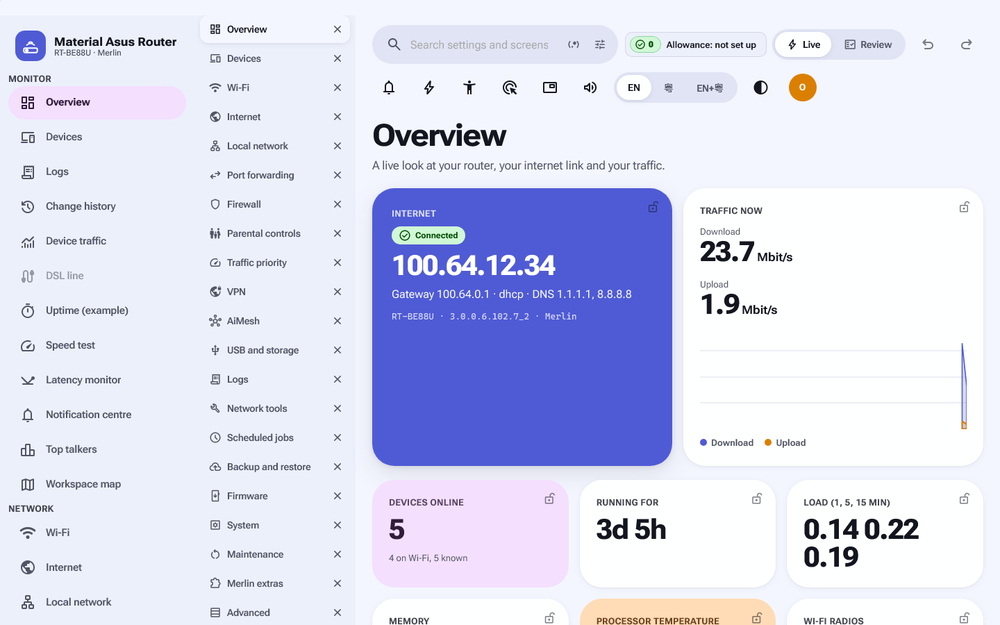
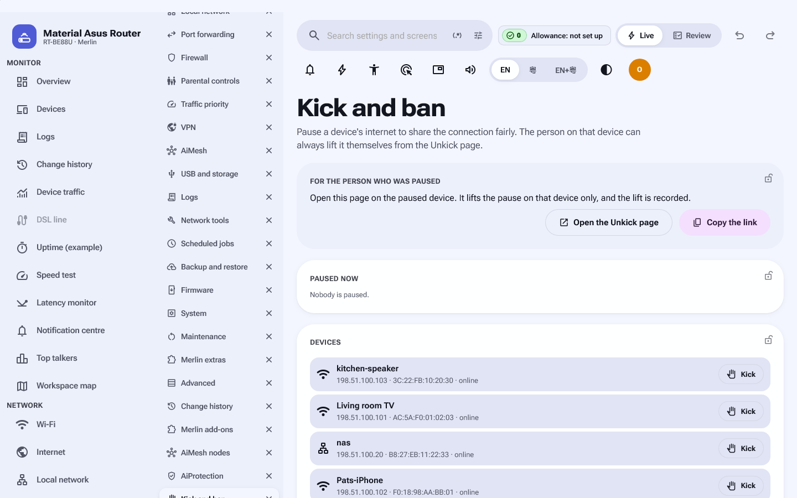
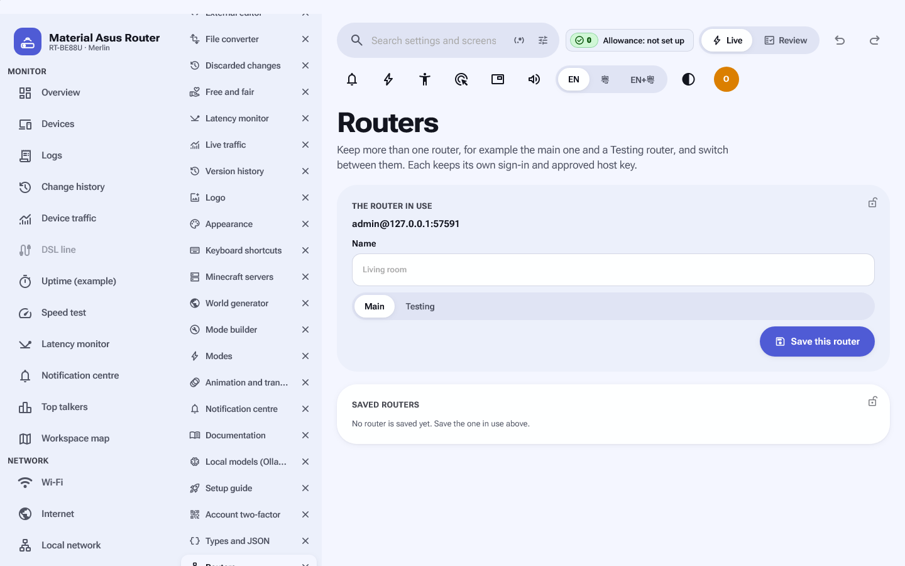
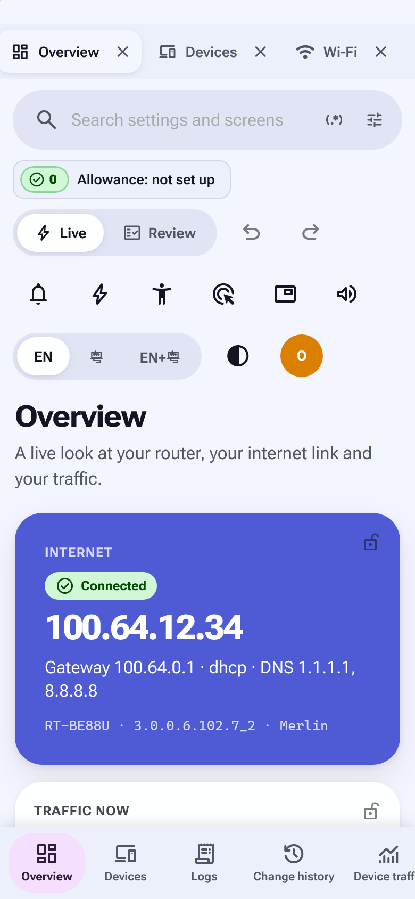
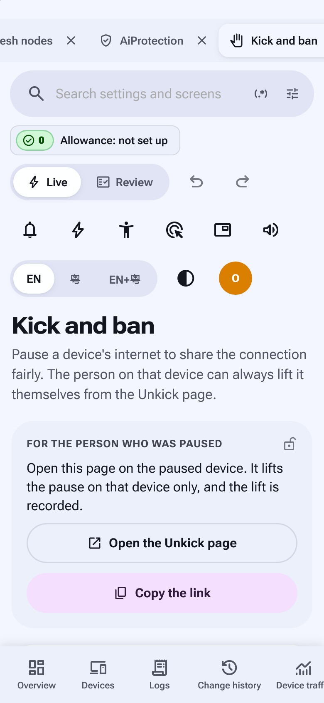
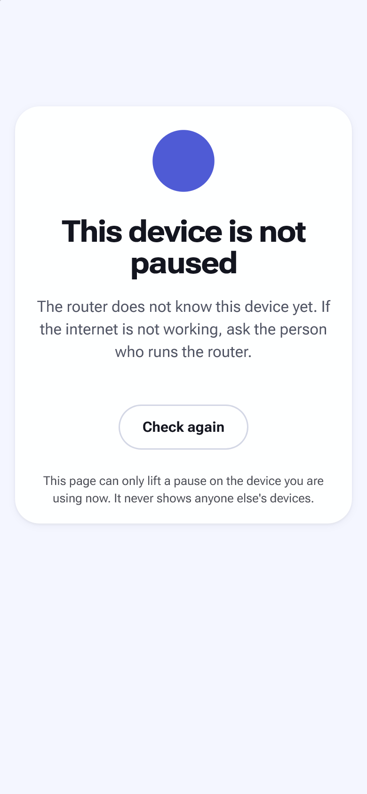

# Material Asus Router

Manage an Asus router (stock ASUS firmware or Asuswrt-Merlin) over SSH from a self-hosted web app.
Every setting is a real control with a preview, a router-side safety timer, a read-back and one-tap
undo.

**Documentation:** <https://ding-ding-projects.github.io/material-asus-router/>



## What it does

- Reads the router's real settings and shows them as typed controls; a setting the router does not
  have is switched off with the reason.
- Live mode applies each change at once; review mode shows a preview first. Every change has an
  impact level, a four-key confirmation when it would disturb people at home more than the
  household chose, a local history, undo and redo.
- You stay signed in, across restarts and updates of the app, until you sign out.
- Kick and ban: pause one device to share the connection fairly. The person on that device can
  always lift it from the Unkick page, without an account.
- Lock IP in the device list, saved routers (Main and Testing), AiMesh nodes, modes, canvas
  editors, diagnostics, an SSH action catalogue and an owner-only terminal.

| Kick and ban | Routers |
| --- | --- |
|  |  |

| Phone: overview | Phone: Kick and ban | Phone: Unkick page |
| --- | --- | --- |
|  |  |  |

## Run it

- **Docker:** `host.bat` (Windows) or `docker compose up -d`; `compose.lan.yaml` gives the app its
  own address on the home network. See the documentation for the setup prompt.
- **Desktop:** the installer and the portable app are attached to every release.
- **On the router:** an Asuswrt-Merlin add-on (`material-asus-router-addon.tar.gz` in each release);
  see `firmware/README.md`.

## Develop

```
npm ci
npm test
DEMO=1 node server/index.mjs
```

Demo mode starts a pretend router, so nothing touches a real one. The HTTP API is listed in
`docs/api/`. Captures in this README come from the demo of the current build (`docs/evidence/`
records how captures were made).

## Licence

MIT. See `LICENSE`.
